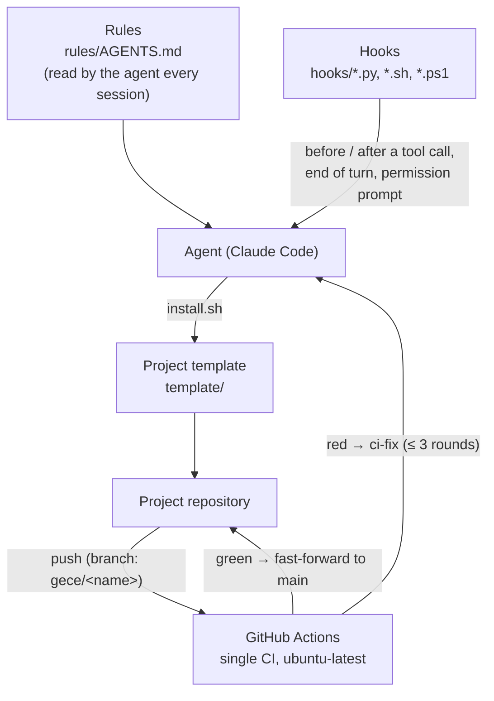

# Architecture — rules, hooks, template, CI

## Layers

| Layer | File | Event | What it does |
|---|---|---|---|
| Rules | `rules/AGENTS.md` | session start | Safety core, modes, quality principles. Text; it does not enforce anything. |
| WAIT mode | `hooks/wait_mode.py` | UserPromptSubmit + PreToolUse | Sets a flag when the message is only a greeting / "opening the session"; while the flag is set it denies every tool call. |
| CI wait | `hooks/ci_wait_hook.py` | PostToolUse + Stop | Records a successful `git push`; while that commit's CI run is in progress it stops the agent from ending the turn, and asks for a warning on timeout. |
| Bash guard | `hooks/bash-guard-lite.sh` | PreToolUse (Bash/PowerShell) | Denies background wait loops with `sleep` (zombie processes) and unbounded `find` on a wide root. Spawns no subprocess (~50 ms). |
| Night watch | `hooks/night-watch.ps1` | PermissionRequest | With the night switch on and in bypass mode, never shows the permission prompt to the user: passes what is on the plan permission list, passes read-only `gh`, denies the rest with a reason and logs it. |
| Template | `template/` | new project | Single CI (gitleaks + Python/Node/Flutter/shell by language), pre-commit (seconds), `.gitignore` (secret patterns), the `ci-fix` skill. |
| Judge | GitHub Actions | push | The real gate. Concurrency cancel, does not run on md-only changes, caching. |

The shared principle of the hooks: **on an error, do not lock the tool** (fail-open) — the one exception is the night watch: with the switch on,
an error is also a deny (if a prompt opens while the user is away, the work stops).

## The previous system ("merkez", May–October 2026) and why it was dropped

| | Merkez (old) | This setup (new) |
|---|---|---|
| Hooks | 8 PowerShell hooks (plugin) + 6 git hooks | 4 small hooks (Python/bash/PS) |
| Gate | Full local gate on every push (minutes, Windows) + 4 workflows | CI only (Linux); second-long gitleaks locally |
| Self-tests | 27 self-test scripts, watchdogs that "test the tester" | One pytest file per hook |
| Evidence | ~2,900 evidence files in the repository | A report line: hash + run-id + test count |
| Template | 7 language templates, 117 files | One template; language blocks switch on by themselves in CI |

Lesson: adding a new watchdog for every agent mistake turned the system into a factory that slowed the product down.
The new setup trusts only proven standard tools and a single CI; the remaining hooks solve only measured, recurring
problems (tool calls when there is no task, saying "done" before CI finishes, zombie wait loops, getting stuck on a permission prompt at night).
